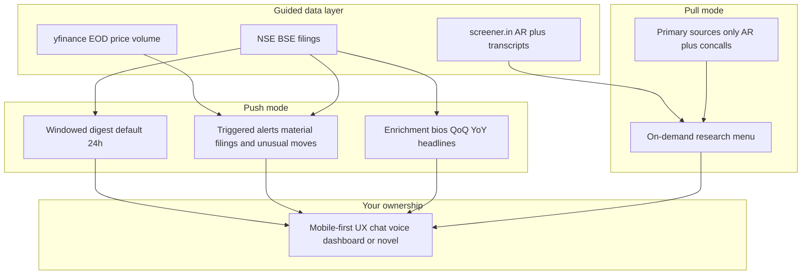

# FINN Challenge — Requirements & Context Understanding Map

**Sources:** [1. ENAM_AI_Engineer_Build_Challenge_Main.pdf](1.%20ENAM_AI_Engineer_Build_Challenge_Main.pdf) · [2. ENAM_AI_Engineer_Build_Challenge_Reference.pdf](2.%20ENAM_AI_Engineer_Build_Challenge_Reference.pdf)

**Workspace / save location (hard rule):** Everything lives in  
`c:\Users\ayush\OneDrive\Desktop\Enam Holdings`  
— understanding map, app code, configs, writeup, exports. Do **not** place project files only under `.cursor/plans` or elsewhere. Build the prototype in this root (or a clear subfolder like `finn/` still inside it).

**Workspace state:** Challenge PDFs + this map + working app in [`finn/`](finn/). Deadline in the brief was **Sun Nov 1, 2026** (release Oct 27); today is **Nov 3**, so submission timing/extensions are an external factor to verify before building.

---

## 1. What this is

| Factor | Detail |
|--------|--------|
| Company | ENAM Holdings — lean public-markets investment firm |
| Product | **FINN** — Financial Investment Agent |
| Hiring lens | Building ability, product instinct, creativity — **not** prior finance expertise |
| North star | Become part of a daily investor’s workflow: filter what matters, bury the rest |

**Core problem (quoted intent):** aggregating info is easy; the scarce skill is **filtering** — surface the few things that matter.

---

## 2. Product shape (what to build)

**Universe**
- Mock portfolio: **15–20** NSE/BSE names (mixed sectors/sizes)
- Ad-hoc set: **3–5** extra names for pull demos
- Hard rule: research must work on **any NSE ticker** with data (judges may point at an unpicked company)

**Ownership split**
- Backend/data: guided (three sources) — get them working, don’t over-engineer
- Frontend/product/interaction/design: **your signal** — where they most want to see how you think

---

## 3. Functional requirements map

### Push — Digest
- Portfolio filings/announcements for a **selectable window** (default last 24h)
- **Prioritize material**; collapse/hide routine

### Push — Alerts (thresholds configurable)
- Material announcement types cared about (e.g. results, M&A, management change)
- Unusual EOD: volume **>~2×** recent average, or price **±X%** in a day

### Push — Enrichment (high-value examples)
- Management change → short incoming bio (e.g. LinkedIn-style context)
- Quarterly results → Revenue, EBITDA, PBT, PAT with **QoQ + YoY** from the filing
- Other types → judgment: one-line summary or priority placement

### Pull — Research menu (pick depth; not a mandatory checklist)
1. Business snapshot  
2. Financial snapshot  
3. Trajectory  
4. Balance sheet  
5. Cash quality  
6. Narrative vs numbers  
7. Guidance  
8. Bull vs bear  

**Pull discipline (hard):** ground only in **annual reports + concall transcripts**. Disallowed: broker notes, news, research reports, model parametric knowledge of the company.  
**Highly valued worked example:** last four quarters vs management guidance — **promised vs delivered**.

### Quality bar
- “No AI slop” — core, concise, beautiful, interactive
- Density + design both count
- Point of view on **how** an investor interacts, not just what data to dump

---

## 4. Domain scaffolding (Reference PDF)

Optional announcement taxonomy (`use / adapt / ignore`):

| ID | Role for product judgment |
|----|---------------------------|
| `results`, `M&A`, `fund_raise`, `management_change` | High materiality → digest top / alerts |
| `litigation`, `credit_rating`, `pledging`, `insider_trading` | Risk / dig-deeper signals |
| `earnings_call`, `investor_meetings`, `capex`, `dividend`, `bonus_split` | Contextual / mid priority |
| `press_release`, `postal_ballot`, `agm_egm` | Situational |
| `unclassified` | Routine noise — collapse/hide (ESOPs, compliance certs, ESG, auditor appointments) |

**Document richness (for pull):** AR = richest primary source → quarterly results = current but thinner → concall transcript = guidance/tone → investor presentation = KPIs/segments → exchange filing = push raw feed.

**Glossary anchors for pull outputs:** Revenue, EBITDA, PBT, PAT, margins, D/E, working-capital cycle, FCF/cash conversion, QoQ/YoY, promoters/pledging, contingent liabilities, RPTs, auditor qualification.

---

## 5. Non-functional & evaluation factors

| Dimension | What matters |
|-----------|--------------|
| Form factor | Mobile-first; phone-tryable (deployed link, Expo/TestFlight, or responsive web) |
| Scope philosophy | Thin-but-working ≫ broad-but-broken; non-running demo = worst outcome |
| Graded | Creativity, product sense, judgment, architecture, how/what you build |
| Bonus | Efficiency — free-tier friendly; smart model routing, caching, chunking |
| Not graded as primary | Completeness, prior finance knowledge |
| Models | Unrestricted (local/OSS/commercial); choice per step is part of evaluation |

---

## 6. Deliverables & submission

1. Working mobile-first prototype  
2. GitHub repo  
3. AI build history (Cursor/Claude/ChatGPT exports)  
4. Short writeup: what built, trade-offs, deliberate omissions, next steps  
5. Email **assessment@enam.com** · subject exactly: `ENAM - IIT screening - 2027`

---

## 7. Suggested build focus (judgment map — not yet implementing)

Given “smallest thing that proves you can build the real thing well,” a coherent thin slice:

1. **One push workflow done beautifully** — windowed digest with materiality filter + 1–2 enriched card types (results QoQ/YoY and/or management change)  
2. **One pull workflow with analytical edge** — e.g. narrative-vs-numbers / promised-vs-delivered on AR + transcripts for portfolio + at least one arbitrary NSE ticker path  
3. **Configurable unusual-move alerts** at EOD (even if polled, not true realtime)  
4. **Mobile-first POV UX** — not a generic chat dump  

Defer: full 8-module pull menu, perfect classification, LinkedIn scraping reliability, multi-user auth, realtime push notifications.

---

## 8. Open factors / risks

- Deadline may already have passed relative to user_info date — confirm before investing build time  
- Push channel (in-app feed vs OS notifications) unspecified — in-app feed is the safe demo path  
- Scraping ToS for NSE/BSE/screener/LinkedIn not addressed in brief  
- “Material” beyond category list is product judgment  
- No formal numeric rubric — demo reliability + POV outweigh feature count  

---

## 9. One-sentence brief

Build a **mobile-first FINN** that **pushes** filtered portfolio filings and configurable unusual-move alerts (with smart enrichment), and **pulls** primary-source (AR + transcript) research for arbitrary NSE names — graded on **judgment, product craft, and a working phone demo**, not feature completeness.
